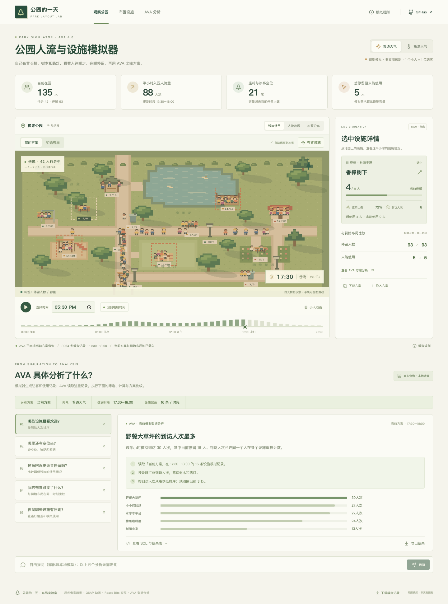
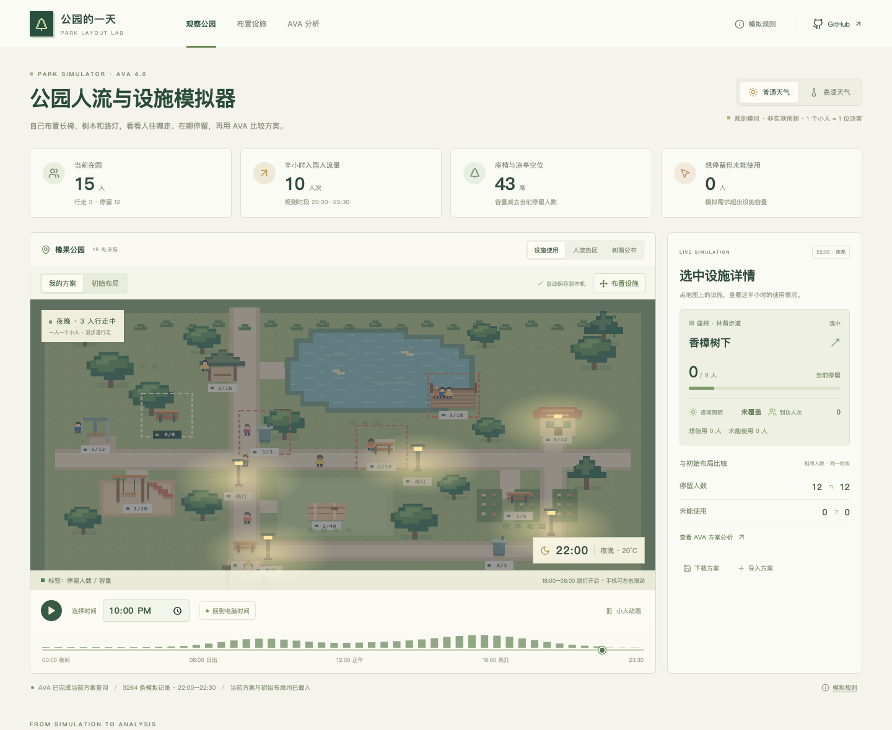

# 🌳 公园的一天 · 公园人流与设施模拟器

**自己布置长椅、树木和路灯，看看人往哪走、在哪停留，再用 AVA 比较方案。**

[在线体验](https://holly1226.github.io/park-day/) · [模拟与数据口径](docs/PRODUCT.md) · [投稿文案](docs/SUBMISSION.md)



## v2 可以做什么

- 默认显示你电脑的本地时间，可选择全天任意时间，或播放公园的一天。
- 一人一个小人，展示行走与停留；人数与 AVA 查询出的全园快照一致。
- 白天有移动的树影，傍晚有暖光，18:00 后路灯与建筑灯光开启。
- 进入「布置设施」，拖动设施、增添长椅/凉亭/饮水点/树木/路灯、调整容量或移除。
- 支持撤销、重置、保存到本机、下载/导入布局 JSON；可切换当前方案与初始布局。
- 使用 AVA 分析最受欢迎的设施、空余座位、树荫附近的停留、布局变化及夜间照明。
- 每个分析显示当前方案与时段、三步计算说明、实际 SQL、返回表和 CSV 导出。



## AVA 到底查询什么？

交互分成三个部分：

1. **你布置设施**：修改位置、类型、容量、树木和路灯。
2. **模拟器生成人流记录**：访客按公开规则选择走路、停留或因为满员无法使用。
3. **AVA 读取记录并计算**：筛选当前方案、天气和半小时时段，计算人流、空位和与初始布局的差异。

例如「哪里还有空位坐？」对应：

```sql
SELECT name AS "设施", capacity-occupied AS "空余座位",
       ROUND(shade_ratio*100) AS "遮阴%"
FROM data
WHERE scenario='current' AND weather='mild' AND hour=17.5
  AND record_type='facility' AND kind IN ('座椅','凉亭')
  AND capacity>occupied
ORDER BY "空余座位" DESC;
```

AVA 4.0.4 的 `source/schema/semantic/query` 真实执行，浏览器使用社区 DuckDB-Wasm 引擎。地图快照、全园人数、时间曲线、方案对比和五类查询都读取返回结果。同一连接串行执行查询，布局替换与整批查询在同一队列中完成。

**在线预设分析无需密钥。** 这些问题使用固定 SQL，文字总结根据结果模板生成；像素场景、访客行为和图表由项目代码实现。配置本地模型后，`analyze()` 支持自由提问，接收当前布局和场景。

## 模拟数据如何理解？

这是虚构公园的**规则模拟**，不是实测、实时监测或经过校准的人流预测。

- 相同天气、时段下，初始与当前方案使用相同访客人数。设施布置影响他们的选择，不凭空改变总人数。
- 访客按设施容量、步道距离、类型节律、遮阴和灯光权重选择目标；满员则记为「未能使用」。
- 树冠投影影响遮阴；18:00–06:00 路灯开启，在 165 地图单位内标记照明覆盖，夜间降低无灯设施吸引力。
- 每个时段有设施记录和一条全园记录，用 `record_type` 区分。全园在场 = 行走 + 停留；设施停留合计 = 全园停留。
- 全园「入园人次」与设施「到访人次」分别生成；设施到访可重复，不能和全园记录混加。
- 结果已经包含人为设定的遮阴和照明偏好，因此不能拿这些比较证明真实的因果效应。
- 行走路径、阴影、日出日落与灯光范围用于交互示意，不是寻路、地理日照或照度仿真。

模拟规则：[src/data.ts](src/data.ts)；SQL 与解释：[src/queries.ts](src/queries.ts)；AVA 队列：[src/engine.ts](src/engine.ts)。

## 本地运行

需要 **Node.js 24+**、npm 和现代浏览器。

```bash
git clone https://github.com/holly1226/park-day.git
cd park-day
npm ci
npm run dev
```

默认地址 `http://127.0.0.1:5173`。macOS 也可运行根目录 `Start.command`。首次安装会把固定版本 DuckDB Wasm 和 Worker 复制到 `public/duckdb/`，约 75 MB；浏览器实际选择一个版本加载。运行不依赖外部 CDN 或在线字体。直接双击 HTML 不支持模块与 Worker，请启动本地服务。

### 可选：自由提问

复制 `.env.example` 为 `.env`，填入 OpenAI 兼容模型的配置：

```dotenv
AVA_MODEL=your-model-name
AVA_API_KEY=your-api-key
AVA_BASE_URL=https://your-provider.example/v1
```

保持 `npm run dev` 运行，在另一个终端执行：

```bash
npm run ai
```

密钥只由本地服务读取。模型调用会将问题、数据结构和相关结果发送到你配置的模型提供商，可能产生其 API 费用。GitHub Pages 仅托管静态页面，不托管此服务。不要将密钥写入 `VITE_*` 或客户端代码。

## 验证与发布

```bash
npm test
npm run build
npx playwright install chromium
npm run test:e2e
```

单元/集成测试检查人数守恒、容量约束、布局比较、树荫与照明、无效导入、CSV、真实 AVA 计算和模拟模型端点的完整 `analyze()` 调用链。浏览器测试检查电脑时间、实际动画位移、全天时段、昼夜灯光、拖动与增删、撤销与持久化、空布局、移动端、五类分析和失败恢复。模拟模型端点不代表验证了实际模型回答质量。

GitHub Actions 自动运行测试、构建和部署 GitHub Pages。仓库 Settings → Pages 的 Source 选择 GitHub Actions。生成的 Wasm 不提交 Git。

## 设计与依赖许可

原创 SVG 像素公园、React、Vite、TypeScript、Lucide。

- [AntV AVA](https://github.com/antvis/AVA) `4.0.4`
- [AVA Engine DuckDB-Wasm](https://github.com/yvonneyx/ava-engine-duckdb-wasm) `0.1.1`
- [GSAP](https://gsap.com/) + `@gsap/react`：访客路径、场景入场；遵循其许可证。
- [React Bits ClickSpark](https://github.com/DavidHDev/react-bits)：布置工具点击反馈。该组件采用 MIT + Commons Clause，完整许可保留在 [public/licenses/react-bits.txt](public/licenses/react-bits.txt)；不受本仓库 MIT 的再次授权。

本项目原创代码 MIT © 2026 holly1226，第三方依赖与组件保留各自许可。
