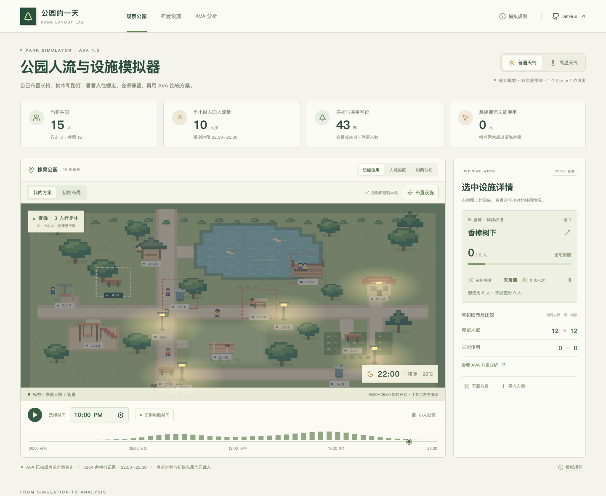

# 投稿文案（手动发布至 AVA #1035）

## 🌳 公园的一天 · 公园人流与设施模拟器

我做了一个基于 AVA 4.0 的像素公园布局实验室：自己布置设施，看见人流与昼夜变化，再用数据比较方案。

进入页面默认跟随电脑时间，也可选择全天任意时间。白天树影移动，夜间路灯亮起；一位模拟访客对应一个小人，沿步道行走或在设施旁停留。可以拖动设施，添加长椅、凉亭、饮水点、树木和路灯，调整容量并保存布局。

**AVA 的实际作用：** 模拟器生成初始与当前布局的记录，AVA source/schema/semantic/query 真实执行。它读取当前方案、时段和天气，计算全园人数与人流、设施到访、空余座位、无法使用的人数、照明覆盖，以及与初始布局的差异。每条分析都显示三步计算说明、SQL 和实际结果表，支持导出。

在线五类预设分析无需密钥。配置本地模型后，可通过 AVA analyze 对当前布局自由提问。场景与访客行为由项目代码模拟，AVA 负责数据分析。全部数据明确标记为规则模拟，不是实际监测或人流预测。

**体验：** https://holly1226.github.io/park-day/

**源码：** https://github.com/holly1226/park-day

# 90 秒演示

1. 打开页面：时间跟随电脑，小人数与总览人数一致，说明这是规则模拟。
2. 拖动到中午，再切换到 22:00：查看树影、暗场、路灯和人流变化。
3. 进入「布置设施」，移动一张长椅，再添加一棵树或一盏灯。
4. 点击「我的布置改变了什么？」：看同一时段的当前与初始方案比较。
5. 点击「哪里还有空位坐？」：看筛选条件、公式、地图与结果。
6. 展开 SQL 与实际返回表，导出数据；下载布局，刷新后验证保留。

# #1061 报名模板

作品：公园的一天 · 公园人流与设施模拟器

作品评论链接：发布 #1035 评论后填写。

参会意向：按本人实际安排填写。
