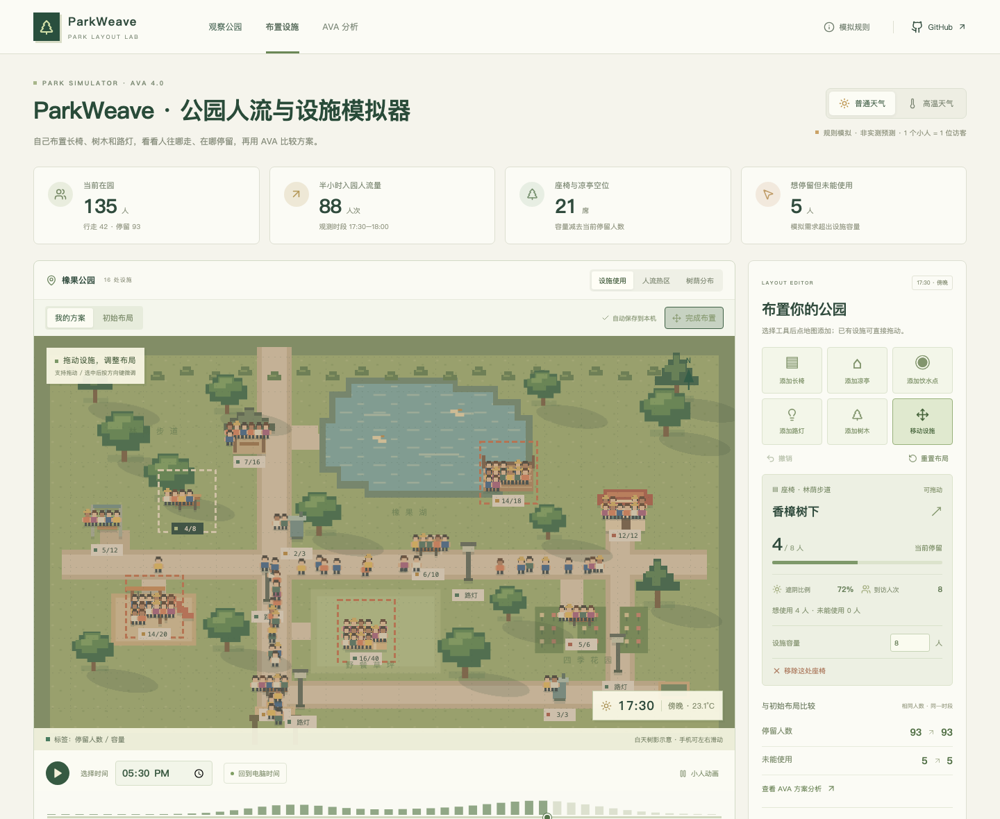

# ParkWeave 投稿与演示说明

## 🌳 ParkWeave · 公园布局与人流模拟器

[GitHub 源码与运行文档](https://github.com/holly1226/park-day) · [在线体验](https://holly1226.github.io/park-day/?v=parkweave)

我做了 **ParkWeave**，一个基于 AVA 4.0 的像素公园布局实验室。希望把公共空间里的“人流、停留、设施使用”变成可以亲手调整、观察和比较的过程：**布置设施 → 模拟访客行为 → 用 AVA 分析方案差异。**

- **自己布置公园**：拖动设施，添加长椅、凉亭、饮水点、树木和路灯，调整容量；支持撤销、本机保存及方案导入导出。
- **看见公园的一天**：默认跟随电脑时间，也可选择全天时段；一个小人对应一位模拟访客，展示行走与停留，树影、明暗和夜间灯光随时间变化。
- **带着问题比较布局**：哪里还有空位坐？哪些设施更受欢迎？添加树木或路灯后，当前方案与初始布局的使用情况有什么变化？

### AVA 的使用方式

使用 **`@antv/ava@4.0.4` + 社区 DuckDB-Wasm 引擎**，在浏览器真实执行 `source / schema / semantic / query`：载入初始与当前布局的模拟记录，筛选方案、天气和半小时时段，计算全园人数、设施到访、空余座位、未能使用人数及布局前后差异。地图快照、时间曲线和分析结果均由实际查询结果驱动。

每个分析都能查看**三步计算说明、实际 SQL 和返回数据表**，并导出结果。在线五类预设分析无需密钥；配置本地模型后，可通过 AVA `analyze()` 对当前布局自由提问。

目前使用明确标注的**规则模拟数据**：访客行为和像素场景由项目代码实现，AVA 负责数据分析；同一天气、同一时段的两个布局使用相同访客人数，结果用于交互演示与布局探索，不作为真实公园人流预测。

### 效果展示

| 布置设施与人流观察 | 昼夜变化与夜间灯光 |
| --- | --- |
|  |  |

可以先把时间调到 **17:30**，添加一张长椅或一棵树，再点 **“我的布置改变了什么？”**，查看 AVA 给出的比较与计算依据。

# 90 秒演示

1. 打开页面：时间跟随电脑，小人数与总览人数一致，说明这是规则模拟。
2. 拖动到中午，再切换到 22:00：查看树影、暗场、路灯和人流变化。
3. 进入「布置设施」，移动一张长椅，再添加一棵树或一盏灯。
4. 点击「我的布置改变了什么？」：看同一时段的当前与初始方案比较。
5. 点击「哪里还有空位坐？」：看筛选条件、公式、地图与结果。
6. 展开 SQL 与实际返回表，导出数据；下载布局，刷新后验证保留。

# #1061 报名模板

作品：ParkWeave · 公园布局与人流模拟器

作品评论链接：发布 #1035 评论后填写。

参会意向：按本人实际安排填写。
